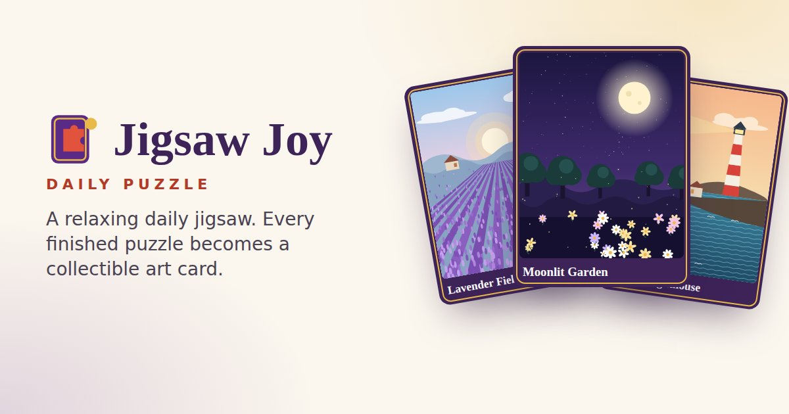

# Jigsaw Joy — Daily Puzzle

A relaxing daily jigsaw game where every completed puzzle becomes a collectible art card.

Every day (UTC) brings one new puzzle, the same for everyone. Drag the pieces from the tray onto the board, and when the last piece locks in, the artwork flips into a numbered **Daily Card** for your collection. You don't need an account and there are no ads or purchases.

> Designed and prepared for YouTube Playables submission. It has not been reviewed, approved or certified by Google/YouTube.



## Features
- **Daily Puzzle.** A deterministic puzzle every UTC day: #001 is 2026-10-01. Difficulty follows a weekly rhythm.
- **Collectible cards.** Each solved daily becomes a card showing the artwork, title, number, date, time and difficulty.
- **Practice mode.** Replay any unlocked artwork at Easy (9), Medium (16), Hard (25) or Expert (36) pieces. It never touches the daily.
- **Collection.** Your cards, newest first.
- **32 original illustrations** across nature, landscapes, architecture, flowers, geometric, abstract, peaceful and seasonal themes.
- **Interlocking pieces** generated deterministically from a seed, with snapping, a proximity hint, a wrong-spot wiggle and a completion reveal.
- **Plays anywhere.** Works at every aspect ratio (9:32 to 32:9) with mouse, touch or keyboard.
- **Saves automatically.** Progress is kept, and an unfinished puzzle resumes after a reload.
- **Accessible.** Keyboard play, screen-reader announcements, reduce-motion, sound and vibration toggles, and difficulty shown by more than colour.
- **Tiny.** About 31 KiB gzip before the game is interactive, with no runtime dependencies.

## Technology
- TypeScript and Vite 8.
- HTML5 Canvas 2D for the puzzle (one canvas, pre-baked sprites, frames drawn on demand) and light DOM/CSS for the menus.
- Web Audio synthesis for sound, so there are no audio files.
- Vitest for unit tests.
- No frameworks and no runtime npm packages.

## Controls
| Action | Touch | Mouse | Keyboard |
|---|---|---|---|
| Take a piece | Pull it out of the tray | Press on it | ←/→ select, Enter lift |
| Move / place | Drag, then release near its home | Drag, then release | Arrow keys choose cell, Enter place |
| Scroll the tray | Swipe along the tray | Mouse wheel | (selection auto-scrolls) |
| Put a piece back | Drop it on the tray | Drop it on the tray | Esc cancels a lift |
| Preview image | Eye button | Eye button | G |
| Pause | Pause button | Pause button | P |

## Local development
```bash
npm install
npm run dev        # http://localhost:5173
npm test           # 55 unit tests
npm run typecheck
```

## Production build
```bash
npm run build      # → dist/  (GitHub Pages / any static host)
npm run preview    # serve dist/ locally
npm run size       # file-by-file size report
npm run build:playables   # → dist-playables/ + release/jigsaw-joy-playables.zip
```

## GitHub Pages deployment
1. Create a GitHub repository, for example `jigsaw-joy`.
2. Push the code:
   ```bash
   git remote add origin https://github.com/USERNAME/jigsaw-joy.git
   git branch -M main
   git push -u origin main
   ```
3. On GitHub, go to **Settings → Pages → Build and deployment → Source** and choose **GitHub Actions**.
4. `.github/workflows/deploy.yml` then installs, tests, builds and deploys `dist/` on every push to `main`. You can also run it from the Actions tab.
5. Open **https://USERNAME.github.io/jigsaw-joy/**.

All asset paths are relative (`base: './'`), so the same build works at any sub-path. See [docs/DEPLOYMENT.md](docs/DEPLOYMENT.md).

## YouTube Playables readiness
- The official SDK (`https://www.youtube.com/game_api/v1`) loads before any game code in the `playables` build.
- Lifecycle calls: `firstFrameReady` → `gameReady`.
- Cloud save through `loadData`/`saveData`, with loads always awaited before saves.
- `onPause`/`onResume`, and no Page Visibility API.
- Audio respects `isAudioEnabled`/`onAudioEnabledChange`.
- `sendScore` sends the number of cards collected.
- No external calls, links, ads, sharing prompts or quit button.
- The bundle is checked automatically at build time.

Details and the items that still need manual verification are in [docs/YOUTUBE_PLAYABLES_COMPLIANCE.md](docs/YOUTUBE_PLAYABLES_COMPLIANCE.md). Metadata thumbnails (16:9, 1:1, 9:16) are in `promo/`.

## Adding puzzles
Edit `src/daily/puzzles.json` and add SVG art to `public/assets/art/`. See [docs/GAME_DESIGN.md](docs/GAME_DESIGN.md#content-pipeline). `npm run art` regenerates the bundled illustrations.

## Project structure
```
src/
  core/        config, state machine, timer
  daily/       puzzles.json + deterministic registry
  puzzle/      generator, engine (rules), layout, renderer (canvas), controller (input)
  game/        app shell & screens, puzzle session, art loader
  cards/       collectible card component
  ui/          DOM helpers, icons
  audio/       synthesised sfx, haptics
  storage/     versioned save data + save manager
  playables/   PlayablesAdapter: Production (ytgame) / Development / Inert
  utils/       rng, UTC dates, formatting
public/assets/art/   32 original SVG illustrations
tests/               Vitest unit tests
tools/               art & schedule generators, Playables packager, size report
docs/                compliance, performance, privacy, design, deployment, QA, final checklist
```

## Privacy
No accounts, no personal data, no analytics, no tracking. Progress is stored in your browser, or in your YouTube game save on Playables. See [docs/PRIVACY.md](docs/PRIVACY.md).

## License
Copyright © 2026 Sonu. All rights reserved. See [LICENSE](LICENSE).

## Credits
- Game design, code, illustrations, icons, logo and sound design are original to Jigsaw Joy.
- The illustrations are generated procedurally by `tools/generate-art.mjs`.
- Sounds are synthesised with Web Audio.
- Built with Vite, TypeScript and Vitest (dev tooling only).
